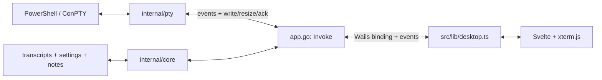

# Architecture

ATC is a Windows app: a Go and Wails host with a Svelte 5 and xterm.js 6 frontend. Go
owns the ConPTY processes, transcript discovery, usage accounting, settings and notes.
The frontend owns terminal rendering, the sidebar, tab state and saved tab descriptions.

Until 0.3.1 the host was Rust and Tauri. Its tests were ported to Go, and its index and
cost output over the fixture corpus is frozen in `fixtures/rust-contract.json`, which the
Go tests still have to match. [docs/WAILS-MIGRATION.md](docs/WAILS-MIGRATION.md) has the
measurements from that move.

## Desktop boundary

`main.go` embeds `dist/`, creates the Wails window, and starts and stops `App`. `app.go`
exposes a single binding, `Invoke(command, args)`. `src/lib/ipc.ts` holds the typed
command functions; `src/lib/desktop.ts` does the Wails calls, events, PTY channels,
notifications, save dialogs and zoom. A failed command rejects its promise with a
readable error.

A PTY channel subscribes before the spawn. Output arrives as `{t:"o", d}` and exit as
`{t:"x", code}` on the channel's own topic, and the listener detaches on exit or on a
failed spawn. The other events are `index://updated`, `settings://updated` and
`notes://updated`.

## Go modules

| File | Does |
|---|---|
| `app.go` | Lifecycle, command dispatch, PTY registry, file watching, migration |
| `limits.go` | Claude's plan-limit HTTP request and Codex's app-server limits |
| `internal/pty/pty_windows.go` | Shell choice, ConPTY, UTF-8 streaming, backpressure, process cleanup |
| `internal/pty/conpty.go` | Loads the bundled `conpty.dll` beside the exe, else the one in Windows |
| `internal/core/settings.go` | Defaults, paths, atomic saves, agent command lines and quoting |
| `internal/core/validate.go` | Settings JSON validation and legacy defaults |
| `internal/core/index.go` | Claude and Codex discovery, metadata, grouping, the disk cache |
| `internal/core/costs.go` | Incremental token accounting, deduplication and pricing |
| `internal/core/prices.json` | Built-in prices; files in the config directory override them |

## Terminal transport

ConPTY runs every shell. When `conpty.dll` and `OpenConsole.exe` sit beside the exe, ATC
uses them: Windows Terminal's newer ConPTY, fetched by `scripts/conpty.mjs` at build
time. Otherwise it uses the copy built into Windows, which swallows OSC 10/11 colour
queries, so Codex's prompt bar comes out the wrong colour.

The shell is PowerShell 7 if installed, else Windows PowerShell. The `terminal.shell`
setting prefers one of them, and `terminal.loadProfile` off adds `-NoProfile`; both reach
Go in the spawn options (`pty.Options.Shell` and `NoProfile`). `ATC_SHELL_NO_PROFILE=1`
does the same for the e2e tests. Child shells lose the launcher's agent markers and
`NO_COLOR`, and get `TERM=xterm-256color`. Without that, oh-my-posh renders black.

A blocking reader puts 32 KiB buffers into a 16-slot queue. A pump decodes UTF-8 across
read boundaries, batches for 8 ms and sends chunks of at most 7,900 encoded bytes. xterm
acknowledges the UTF-8 byte count once it has parsed a chunk. The reader pauses above
2 MiB unacknowledged and resumes below 256 KiB, so a slow renderer slows the shell instead
of growing memory. A startup watchdog answers ConPTY's cursor-position request if xterm
has not, and exit waits for queued output to drain.

Each tab has its own shell. Busy detection looks at the shell's child processes. Closing a
busy tab asks first, unless `ui.confirmClose` is off, and a confirmed close kills the
process tree. Quitting stops the limit helpers, the watchers and every owned PTY.

## Agents

`core.AgentCommand` builds the PowerShell line that starts Claude or Codex: the command,
`--no-daemon` for Codex, the `args` setting, the `chatArgs` setting for chats, then
`resumeArgs` with `{session}` filled in. Arguments are quoted with `core.Argument`, which
leaves plain words alone and single-quotes the rest. The line is typed into the tab's
shell 400 ms after it starts.

Chats start in the scratch directory with chat arguments. Claude's defaults are
`--tools=` and `--strict-mcp-config`: no built-in tools and no MCP servers. Codex has no
switch for its tools or MCP servers, so its default is `--sandbox read-only`. Chats
started before 0.6.0 live in `<config>/chats`, which is still indexed into the Scratch
view. A chat tab's key is `agent:<provider>:chat-N`, and saved tabs carry `chat: true`, so
a restored chat keeps its arguments.

The task box opens a tab with the agent command plus the task as one quoted argument,
waits a frame so the PTY spawns at its real size, then refocuses the previous tab. Reply
and broadcast use `sendText`, which writes the text, then Enter 50 ms later. In one
write, Claude Code reads the pair as a paste and keeps the newline in its prompt.

## Discovery and persistence

For Claude, the index reads up to 300 lines or 512 KiB from the head of each transcript,
and the last 64 KiB for renames. It stops early only for an `ai-title`, which often sits
below the first user turn. Human turns are those with `origin.kind == "human"`, with a
string check for files older than that field. Codex transcripts are read incrementally,
keeping partial-record offsets, native ids, activity and child links. Size and
modification time invalidate cache entries. The cache, `index-go.json`, can always be
regenerated.

A session is `provider:id`, with `claude` or `codex` as the provider. A bare id from older
settings means Claude. Discovery groups sessions by canonical working directory, applies
pins and renames, and hides child and archived Codex sessions. Usage still counts child
work, under its parent.

The watcher covers `settings.json`, `notes.md`, Claude's project directories and Codex's
sessions and name index. It watches the nearest existing parent when a root is missing,
and picks up new directories as they appear. Events debounce for 300 ms, and transcript
growth that changes nothing in the sidebar is dropped.

Settings and notes live in `%APPDATA%\Agent Terminal Control`, or `ATC_CONFIG_DIR`.
`Merge` keeps only keys present in `Defaults()`, so a new setting needs a default there or
it never saves. Older settings locations migrate on load. When `notes.md` does not exist,
tasks from `tasks.json` (or from inside `settings.json`) are written into it once as a
checklist; `tasks.json` itself is left alone. A malformed external edit leaves the current
settings in place. Saves write a unique temporary file, rename it, and retry when Windows
reports a sharing conflict. A mutex serializes saves and watcher reloads, and ATC's own
saves are not echoed back into an editor that is open.

The WebView2 profile is `webview-wails` under the config directory, so localStorage
(saved tabs, the notes pane's size, the usage range) lives there.

## Usage

Claude accounting deduplicates response records and counts cache reads and both cache
write durations. Codex prefers structured response usage from its first appearance;
older cumulative records count before that point, and a counter reset starts a new
epoch. Prices match exact model names or known dated snapshots. An unknown model stays
unpriced and marks its totals partial.

Claude's plan limits use the credentials in `CLAUDE_CONFIG_DIR`, else `~/.claude`, and
never leave Go. Codex limits start the configured CLI as `codex app-server`, run
initialize and `account/rateLimits/read`, then stop it. One provider failing never hides
the other. The header's usage chip shows Claude's 5-hour session limit (`chipLimit` in
`src/lib/plan.ts`) and the time until it resets.

## Frontend

| Path | Does |
|---|---|
| `src/App.svelte` | Layout, the pane header (or `TabBar` with `ui.showTabBar`), every chord's action, launching and restoring tabs, toasts |
| `src/terminal/manager.ts` | Every xterm instance and PTY: open, close, split panes, mosaic, WebGL budget, fitting, state marks, output history, `screenLines`, `sendText` |
| `src/sidebar/Sidebar.svelte` | The Sessions, Open and Scratch views, the filter, the notes pane |
| `src/sidebar/OpenList.svelte` | The Open view: triage order, sections, peek, output graph, Reply, broadcast |
| `src/sidebar/TaskBox.svelte` | The task box at the top of the Open view |
| `src/lib/triage.ts` | `triageOrder`, `nextWaiting`, `triageGroup`, `peekLine` |
| `src/lib/stores.svelte.ts` | `appState`: index, settings, notes; zoom, animation speed, refresh intervals |
| `src/lib/keymap.ts` | Chords, the shortcut list, newline handling for Claude and Codex |
| `src/lib/restore.ts` | Parsing saved tabs, which are untrusted |
| `src/settings/SettingsPanel.svelte` | The settings page, saving a moment after each edit |
| `src/usage/UsagePanel.svelte`, `src/tabs/UsageChip.svelte` | The usage page and the header chip |

A tab's state comes from its terminal title. Claude prefixes `✳` when idle and spins
`◐`/`◑` while working; Codex state comes from its session file. `tabMark` turns that into
`working`, `idle`, `interrupted`, `attention` (finished in the background), `open` or
`exited`, and the manager records when each tab entered its mark.

The Open view sorts with `triageOrder`: attention, interrupted, idle, working, open,
exited, longest in state first. The peek is the last readable lines of the screen;
`peekLine` skips box drawing, prompts and key hints with a regex that has to follow the
agents' UIs. `screenLines` joins rows the terminal wrapped, so a peek never splits a word.

The UI zooms with CSS `zoom` on the page, because Wails cannot change WebView2's zoom
after startup. The terminal area undoes that zoom and scales its font, or xterm measures
wrong. Pointer and `getBoundingClientRect` positions are on-screen pixels, while a fixed
element's `left` and `top` are zoomed again, so menus, tooltips and drags divide by
`pageZoom()` from `src/lib/desktop.ts`.

## Gotchas

Things that cost time once. Add to this list.

**Terminals**
- ConPTY sends `ESC[6n` at startup and hangs until something answers. xterm answers, but
  only if `term.onData` is wired to `ptyWrite` before `ptySpawn`. A blank terminal almost
  always means this.
- Spawn after layout settles, at the real size. A shell started at one width and resized
  a moment later looks fine at a prompt, but a resumed Claude session replays its whole
  transcript garbled. `openTab` waits two animation frames, and the first tab waits for
  settings.
- Sizes are tracked per tab (`panesNeedingResize`). One shared "last applied" size made
  every tab after the first keep xterm's 80x24 default.
- Hide panes with `visibility: hidden`. `display: none` measures zero, and FitAddon sends
  that to ConPTY.
- WebView2 keeps about 16 WebGL contexts and silently drops the oldest. Only the most
  recent `gpuTabs` tabs get one, and every addon handles `onContextLoss`.
- xterm 6 has no canvas renderer, `windowsMode` or `fastScrollModifier`.
- Exit comes from waiting on the process, not from the reader. The reader never sees end
  of file while the session holds the pseudo console.
- Output batches on an 8 ms clock, not per read. Tests should check that sends are far
  fewer than lines, not count them.
- Chunks are sized by their encoded length. Escape codes grow six times once encoded for
  the page, and Claude's UI is mostly escape codes.

**Input and focus**
- `attachCustomKeyEventHandler` returning false stops xterm, not the DOM event. A chord
  handled in both places runs twice, which turns every toggle into a no-op. Call
  `stopPropagation`.
- A chord ATC claims never reaches the shell. `keymap.test.ts` checks plain Ctrl+B is not
  claimed, because Claude Code uses it.
- Moving focus to the terminal inside a keydown handler hands it the keypress that
  follows: Enter to finish a rename used to answer a waiting agent with nothing. Move
  focus in a `setTimeout`.
- Windows PowerShell 5.1 drops an empty argument (`''`). Write `--flag=` instead of
  `--flag ""`.

**Svelte and the dev server**
- Runes only compile in `.svelte` and `.svelte.ts` files. In a plain `.ts`, `$state` is a
  value that never updates, with no error.
- Never export anything named `state`; it shadows the rune. The store is `appState`.
- Class names are scoped per component but still collide inside one. A twisty's `open`
  class once picked up the Open view's `.open { flex: 1 }`.
- `manager.ts` keeps terminals in module scope, so a hot update reloads the page instead.
  A pane that goes blank after an edit needs a dev server restart, not debugging.

**Transcripts**
- `~/.claude/projects/<dir>` names are lossy: `D:\Coding\game_tracker_app` becomes
  `D--Coding-game-tracker-app`. Read `cwd` from the JSONL, never decode the name.
- List `*.jsonl` one level deep. `<session>/subagents/*.jsonl` would double the sessions.
- The first human message can be past line 11 or byte 47k, after file-history snapshots.
- `ai-title` often sits below the first user turn. Only an `ai-title` ends the parse early;
  stopping at the first message labels sessions that open with "." by their uuid.
- Human turns are the ones with `origin.kind == "human"`. Older files have no `origin`, so
  the `<command-name>` and `<local-command-caveat>` string checks stay as a fallback.
- `core.Resolve` strips the `\\?\` prefix that symlink resolution adds. PowerShell and
  ConPTY handle it badly, and it never string-matches a transcript's `cwd`.
- A parser change does nothing visible until the cache goes. Bump the `Version` the index
  cache writes in `internal/core/index.go`.

**Tooling**
- Bash heredocs and Python here-strings eat backslashes, and backticks in a `git commit
  -m` run as commands. Write files with a real editor or the Write/Edit tools.
- Never paste a raw ESC byte into source; write "the ESC byte (0x1B)".
- `git worktree remove --force` follows a `node_modules` junction and empties the real
  folder. Delete the junction first.
- A test that waits for a string and then counts it sees one, because the echoed command
  arrives first. Make the shell build the marker, as in `'E2E_' + 'ROUNDTRIP'`.
- Git cannot store an empty directory; fixtures that need one carry a `.gitkeep`.

## Development

`npm run play` runs the dev app on synthetic histories in `playground/config`;
`npm run desktop:dev` runs it on your real ones. Go edits rebuild the host, frontend
edits go through Vite. The launcher mirrors the Go sources into `wails-dev-work/` so Wails
does not scan WebView profiles and build output; that folder is generated. If the dev app
fails with "Timed out waiting for Vite", an earlier run left Vite on port 1420. Stop
that process and start again. `npm run desktop:build` writes `build/bin/atc.exe`, and
`npm run desktop:package` adds the MSI and NSIS installers.

`scripts/shot.ps1` captures the window with `PrintWindow`, which works while it is covered
and never grabs another app. A capture taken mid-scroll can show torn glyphs; take another
before believing it. `scripts/sendkeys.ps1` sends real keys but takes focus. To drive the
UI without taking focus, open the dev server's page (`http://localhost:34115`) in headless
Edge with a remote-debugging port, and use the DevTools protocol to click, type and read.
Import the manager module the app already loaded (its URL ends in `manager.ts?t=…`) to
read terminal text with `screenLines`; WebGL canvases hide it from the DOM. Reloading that
page breaks its terminals, so start a new headless Edge instead.

`npm test` runs Vitest and the Go tests, including native ConPTY tests; on a fresh
checkout run `npm run build` first, since `main.go` embeds `dist/`. `npm run test:e2e`
builds a test binary in `build/e2e` and drives a real WebView2 window over WebDriver with
throwaway fixtures. It needs a desktop, and two of its tests (clipboard, Save dialog) take
focus. It saves screenshots and memory samples in `benchmarks/`. CI runs `npm test` and
`npm run lint` on every pull request, and builds releases from `v*` tags.
